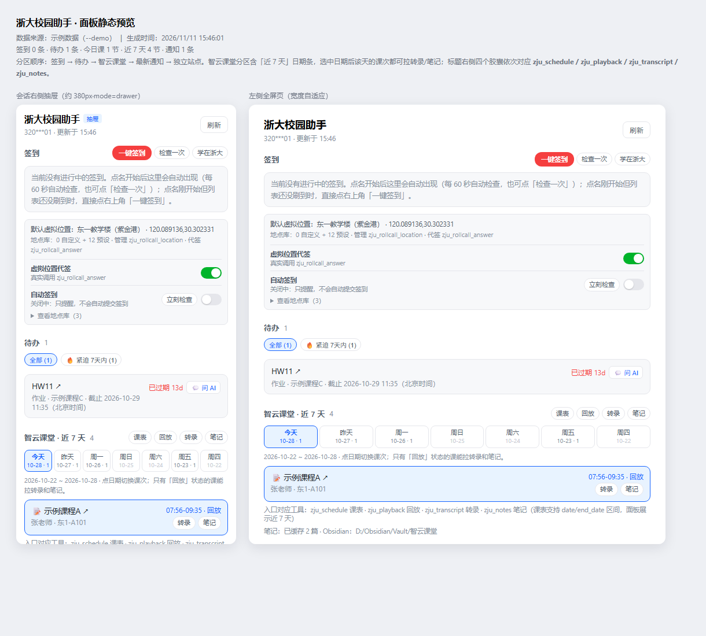
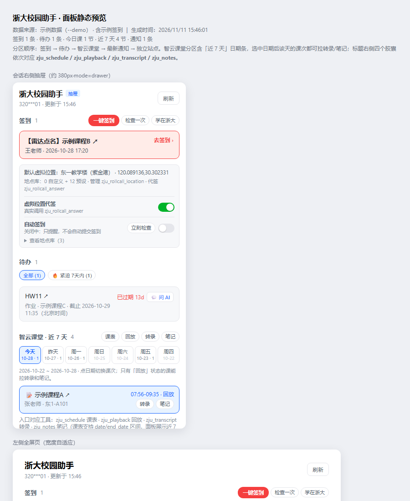
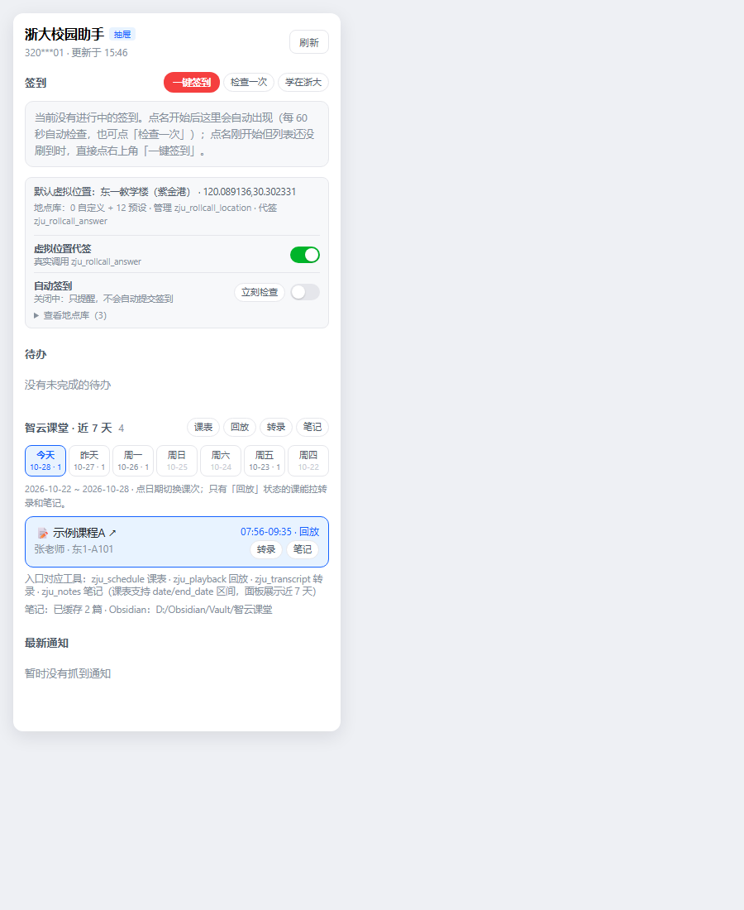

# 浙大校园助手（zju-campus）

DSH Host 插件：把 ZJUAM 统一身份认证、学在浙大、智云课堂和校园公开通知，做成一组模型可直接调用的工具。

- 零第三方依赖，只用 Node 内置能力（`fetch` / `FormData` / `BigInt`）。
- ZJUAM 密码用学校下发的 RSA 公钥加密后提交；凭据保存在本机私有明文配置文件，不回显、不写普通日志。独立校内HTTP系统不继承该密码。
- Cookie 只在内存，进程退出即失效。
- 只允许访问 `*.zju.edu.cn`，重定向到外站直接拒绝。
- 写操作（提交/撤回作业）与虚拟位置代签默认关闭。



<sub>截图由 `node test/preview-render.mjs --demo` 用示例数据生成，学号、课程、教师、教室、路径均为占位值。</sub>

| 会话右侧抽屉（紧凑版） | 签到区特写 |
|---|---|
|  |  |

环境要求：**DSH 0.2.x 及以上**（rc 预发布版也能装），**Node.js >= 20**。不需要 Git、Python 或任何第三方 npm 包；只有想用「课件 OCR」时才额外装 `rapidocr-onnxruntime`。

## 一、配置账号

推荐放在**插件私有文件**里，**不要把密码写进补丁或聊天**：

```bash
# C:\Users\<你>\.dsh\zju-campus\credentials.env
ZJU_USER=你的学号
ZJU_PASSWORD=你的密码
```

保存后不需要重启，下一次工具调用会自动读取。

> **为什么不放 `$DSH_HOME/.env`**：DSH 会把那个文件的变量注入到所有子进程环境，而它的过滤规则只认名字里含 `KEY`/`PASSWORD`/`SECRET`/`TOKEN` 的变量。`ZJU_PASS` 不匹配，密码会出现在每个 shell 的环境变量里；改成 `ZJU_PASSWORD` 能被过滤，但学号仍会漏。放在插件私有文件里最干净——DSH 根本不读它。
>
> 插件仍兼容 `$DSH_HOME/.env`（变量名 `ZJU_PASS` 或 `ZJU_PASSWORD`）和进程环境变量，只是不如私有文件安全。

## 二、安装

在 DSH 里用插件管理工具安装本目录：

```text
plugin_manager install_bundle target = <解压后的插件目录绝对路径>
```

或手动在 profile 的 `package.json` 加 `"@local/zju-campus": "link:<解压后的插件目录绝对路径>"`，并把 `@local/zju-campus` 加进 `dsh.profile.bundles`。

安装后 `include:zju-campus` 行应为 `active`。

## 三、侧边栏面板与会话右侧抽屉

插件支持**双入口并存**，在不同场景下自由使用：

1. **左侧全页面板（左导航栏入口）**：
   - 安装后左侧边栏多出「浙大」图标入口，点开为大页面板。
   - **待办**：支持全部与紧迫筛选，临近截止标红，带一键「💬 问 AI」按钮。
   - **近 7 天课表**：日期条覆盖今天与往前 6 天，点日期即可切换；每节课都能直接「转录 / 笔记」，非今日课程也能回看复习。**点击课程直接打开智云课堂对应课堂**（统一走 `/livingroom`）。
   - **签到提醒**：面板顶部红色「正在进行签到」横幅，并显示当前默认虚拟位置。**默认只提醒，不代签**；配置 `allowRollcallSign` 后可用虚拟位置应答雷达点名。签到区右上角有常驻的红色「一键签到」，下方还有「自动签到」开关：插件进程内每 60 秒查一次，检测到进行中的雷达点名就直接签（每个点名最多试 2 次，失败隔 3 分钟再试），旁边的「立刻检查」可以不让等定时器。
   - **数字点名**：遇到「数字点名」时，签到区会多出一块「数字点名 · 签到码」——自动去智云课堂读这节课的语音转录、最新课件截图，以及**直播摄像头画面**（老师把数字写在黑板上也能看），从里面找出要填的 4 位数字，直接把结果和置信度写在面板上，旁边给一个输入框可以手工改、手工提交。**猜不出来就明说「无法判断，请打开智云课堂自行确认」**，绝不瞎填；平台在 `number_code` 字段里直接给了答案时优先用它。抓到的黑板/投影画面会缩小显示在结果下面，点开看大图，自己也能扫一眼。
   - **最新通知**：求是学院、本科生院、外国语学院、光电学院聚合。
   - **作业入口**：截止时间显示为北京时间；点击直接打开作业详情。
   - **独立校园系统**：大物实验课表、工程训练预习作业截止时间与答题入口。

2. **会话右侧抽屉（对话界面即时唤出）**：
   - 在任何会话窗口中，顶栏右侧工具区（header utilities）新增「浙大」快捷按钮，点击一键展开/收起右侧助手抽屉。
   - 也可通过右侧边栏 `+` 号添加标签页选择「浙大校园助手」。
   - 抽屉模式自适应紧凑排版，方便一边与 AI 对话交流，一边随时对照课表与待办作业。
   - 点击待办旁「💬 问 AI」，系统会自动组装该门作业的提问词并直接填入当前聊天输入框，同时复制到剪贴板，立刻就能向大模型获取解题思路或规划。

## 四、工具（共 23 个）

| 工具 | 作用 | 需要账号 |
|---|---|---|
| `zju_status` | 认证状态、会话有效期、写操作开关 | 否 |
| `zju_login` | 主动登录 / 刷新两套会话 | 是 |
| `zju_logout` | 清除内存会话 | 否 |
| `zju_todos` | 学在浙大未完成待办（支持 `urgent_only` 快速筛 7 天内待办、`type`、`days`） | 是 |
| `zju_courses` | 我的课程（拿 `course_id`） | 是 |
| `zju_homework` | 某课全部作业，含提交状态、得分、评语、`activity_id` | 是 |
| `zju_materials` | 某门课的课件、讲义与资料（含附件名、大小、更新时间），支持关键词过滤 | 是 |
| `zju_schedule` | 智云课堂课表（拿 `sub_id`），支持 `date` / `end_date` 日期区间，如一次查近 7 天 | 是 |
| `zju_playback` | 智云课堂某节课的视频回放直达链接（livingroom 网页播放地址） | 是 |
| `zju_transcript` | 某节课的语音识别转录逐段文本 | 是 |
| `zju_notes` | 取某节课的笔记材料：已有缓存直接返回 Markdown；没有缓存时返回「逐页课件 OCR 文字 + 按 5 分钟分桶的转录（每桶标注讲了哪几页）」，长课用 `part` 分段读全 | 是 |
| `zju_slides_ocr` | 把某节课的课件截图批量 OCR 成文字并缓存（`_附件/<sub_id>/ocr.json`），之后 `zju_notes` 的材料就会带上每页 PPT 的文字 | 否 |
| `zju_save_note` | 保存结构化课堂笔记：`{{slide:N}}` 占位符自动替换成正文内嵌图片、写本地缓存、镜像到 Obsidian | 是 |
| `zju_notes_list` | 列出已缓存的课堂笔记（按日期倒序，可按课程/关键词过滤） | 否 |
| `zju_obsidian` | 查看 / 检测 / 指定 Obsidian 库（`status` / `detect` / `use` / `disable`） | 否 |
| `zju_notices` | 外国语学院 / 光电学院 / 求是学院 / 本科生院公开通知 | 否 |
| `zju_notice_detail` | 通知正文、发布时间、附件链接 | 否 |
| `zju_rollcall` | 查看当前有没有正在进行的点名/签到（默认只提醒，不代签） | 是 |
| `zju_rollcall_location` | 管理雷达点名的虚拟位置点位库：12 个内置点位 + 自定义点位，支持增删改查、设默认、导入导出 | 否 |
| `zju_rollcall_answer` | 用虚拟位置应答雷达点名（写操作，需 `allowRollcallSign` + `confirm: true`；可 `dry_run` 演练） | 是 |
| `zju_lab_materials` | 大物实验课件：列出某次实验的指导书/讲义/PPT，或下载到本地并返回路径 | 独立实验账号 |
| `zju_submit_homework` | 提交作业（写操作，需 `confirm: true`） | 是 |
| `zju_retract_homework` | 撤回作业（写操作，需 `confirm: true`） | 是 |

典型链路：

```
zju_courses → zju_materials（查课件）
zju_courses → zju_homework → zju_submit_homework（交作业）
zju_schedule → zju_playback（看回放）
zju_schedule（近 7 天区间） → zju_transcript / zju_notes（回看非今日课程）
zju_notes（材料） → 模型写结构化笔记 → zju_save_note（缓存 + Obsidian）
zju_notes_list / zju_obsidian（管理已缓存笔记与同步）
zju_notices → zju_notice_detail（看通知）
```

## 五、虚拟位置（雷达点名）

雷达点名要求提交 GPS 坐标，服务端以教学楼信标点为圆心校验 **500 米** 半径。插件内置了参考项目 [ZJU-live-better](https://github.com/5dbwat4/ZJU-live-better) `courses.zju/autosign.js` 里的 12 个常用点位（紫金港东一 / 西教 / 段永平、玉泉教一 / 四 / 七、之江、华家池等），也可以自己添加。

点位库默认存在 `$DSH_HOME/zju-campus/rollcall-locations.json`，文件里只保存自定义点；预设点由代码内置，不占文件。同名自定义点会覆盖预设点，便于修正坐标。

直接对 AI 说即可：

```text
列出签到地点
添加签到地点：东一教学楼 120.089136,30.302331，校区紫金港
把默认签到地点设为东一教学楼
用东一教学楼代签这次雷达点名（先 dry_run 看看会试哪些点）
```

对应工具：

- `zju_rollcall_location`：`list` / `add` / `update` / `remove` / `default` / `resolve` / `import` / `export`。
  坐标格式统一为「经度,纬度」；如果第二个数大于 90，会自动按「纬度,经度」纠正。
- `zju_rollcall_answer`：默认策略 `fallback`，顺序是「指定点位 → 默认点位 → 点位库全部点位 → 三点定位」。
  每次失败会记录服务端返回的 `distance`，凑够 3 个点后用球面最小二乘反推信标位置再试一次。
  `strategy=single` 只试指定/默认点位，适合已经确定坐标的情况。

**开关**：代签是真实写操作，默认关闭。两种打开方式：

1. 面板「签到」区底部的「虚拟位置代签」开关，点一下即时开/关；状态保存在 `$DSH_HOME/zju-campus/rollcall-switch.json`，优先于配置。
2. 在 profile 补丁的 `zju-campus` 行里打开（作为没有面板覆盖时的默认值）：

```yaml
- id: zju-campus
  name: '@local/zju-campus'
  config:
    allowWriteOps: false
    allowRollcallSign: true
    allowIndependentHttp: true
    enableEngineering: true
    sessionTtlMinutes: 15
```

> 注意：profile 补丁里的 `config` 是**整体替换**而不是逐键合并，覆盖 `zju-campus` 时要把原有键一并写上，否则 `allowIndependentHttp` / `enableEngineering` 会掉回默认值。

调用时还必须带 `confirm: true`；想先看会尝试哪些点，用 `dry_run: true`（只查询点名列表，不发送签到请求）。

> 说明：这个能力复刻自开源项目 ZJU-live-better 的虚拟位置思路，仅供学习与个人使用。签到规则由学校制定，使用前请自行确认合规性，风险自负。

## 六、课堂笔记与 Obsidian

一节课的笔记分两步，都是对话里直接说就行：

```text
用 zju_notes 拉一下 10-27 示例物理的课堂材料
（模型生成结构化笔记后自动调用 zju_save_note 保存）
```

1. **`zju_notes`**：有缓存就直接返回已存的 Markdown；没有缓存时拉取
   - 语音识别转录（按 5 分钟分桶，带 `[mm:ss - mm:ss]` 时间段，每桶标注这段讲了第几页）；
   - 课件页（`search-ppt` 接口，按 `created_sec` 排序，标注重点页），**已 OCR 的话逐页列出 PPT 上的文字**；
   - 长课自动分段：材料头写「第 k/N 段」，用 `part=2、3…` 逐段读完再动笔。
2. **`zju_save_note`**：把模型写好的 Markdown 落盘，并
   - 把正文里的 `{{slide:N}}` / `{{slide:N|说明}}` 占位符替换成内嵌图片，做到图文混排；
   - 写入本地缓存 `$DSH_HOME/zju-campus/notes/`（同名笔记覆盖更新，索引存 `index.json`）；
   - 下载课件图片到 `notes/_附件/<sub_id>/`（单张超过 8MB 跳过）；
   - 正文里没有占位符时，才回退到文末「课件时间轴」清单；
   - 配置了 Obsidian 时镜像一份到库内。

**课件 OCR**：课件接口只给图片、不给文字，所以 PPT 上的定义公式要靠 OCR 提取。

```text
先 zju_slides_ocr(sub_id=1234507)     # 逐页识别，缓存到 _附件/<sub_id>/ocr.json
再 zju_notes(sub_id=1234507)          # 材料里就带上每页 PPT 的文字了
```

引擎是 [RapidOCR](https://github.com/RapidAI/RapidOCR)（`pip install rapidocr-onnxruntime`），纯本地离线、约 3.6 秒/页，中文标题、公式结构、表格数字都能出来。解释器路径用配置项 `ocrPython` 指定。

建议的笔记结构（写进提问词里，模型会照做）：

```
## 本节要点 / ## 知识点 / ## 公式与定义 / ## 例题与讲解 / ## 作业与截止时间 / ## 待复习
```

**Obsidian 同步**：库内结构如下，用双链把笔记、课程索引、总索引串起来。

```
<库>/智云课堂/
├── 2026-10-27 示例课程B (1234505).md   # 带 frontmatter：sub_id / course / date / tags
├── _索引.md                                  # 全部笔记的日期表格
├── _课程/<课程名>.md                          # 单门课的笔记列表
└── _附件/<sub_id>/ppt-001.jpg                # 课件图片
```

配置方式（三选一，按优先级）：

1. 对话里说「把 Obsidian 库设为 D:/Obsidian/Vault」→ 写 `$DSH_HOME/zju-campus/obsidian.json`，立即生效；
2. profile 配置 `obsidianVault` / `obsidianFolder`；
3. 什么都不配时自动探测 `%APPDATA%\obsidian\obsidian.json`，**只有一个库**才自动启用。

对应工具：`zju_obsidian action=status|detect|use|disable`、`zju_notes_list`。

## 七、配置项

写在 profile 补丁 `zju-campus` 行的 `config` 里：

| 键 | 默认 | 说明 |
|---|---|---|
| `allowWriteOps` | `false` | 是否允许提交/撤回作业 |
| `allowIndependentHttp` | `false` | 独立校园HTTP系统授权；当前用户明确同意后，本地bundle中已启用 |
| `sessionTtlMinutes` | `15` | 会话缓存时长 |
| `requestTimeoutMs` | `20000` | 单次请求超时 |
| `noticeSources` | `["qsxy","bksy","sis","opt"]` | 通知来源 |
| `tenantId` | `"112"` | 智云课堂租户 id |
| `username` / `password` | 空 | 不推荐，优先用 `.env` |
| `envFile` | `$DSH_HOME/zju-campus/credentials.env` | 自定义凭据文件路径 |
| `allowRollcallSign` | `false` | 是否允许用虚拟位置应答雷达点名（真实签到写操作） |
| `rollcallLocationsFile` | `$DSH_HOME/zju-campus/rollcall-locations.json` | 虚拟位置库文件路径 |
| `rollcallSwitchFile` | `$DSH_HOME/zju-campus/rollcall-switch.json` | 面板代签开关的状态文件 |
| `rollcallAuto` | `true` | 自动签到守护的默认状态（面板开关可覆盖） |
| `rollcallAutoIntervalMs` | `60000` | 自动签到检查间隔（15 秒 ~ 10 分钟） |
| `rollcallAutoMaxTries` | `2` | 同一次点名最多自动尝试几次（1 ~ 5） |
| `rollcallAutoRetryMs` | `180000` | 失败后隔多久再试（0 ~ 1 小时） |
| `rollcallAutoFile` | `$DSH_HOME/zju-campus/rollcall-auto.json` | 自动签到开关的状态文件 |
| `rollcallNumber` | `true` | 数字点名时是否去课堂材料里猜签到码（关掉就不 OCR） |
| `rollcallNumberTtlMs` | `90000` | 识别结果缓存多久（15 秒 ~ 10 分钟），避免刷新面板反复 OCR |
| `rollcallNumberLive` | `true` | 数字点名时是否抓智云直播画面（黑板 + 投影）一起 OCR |
| `rollcallDefaultLocation` | 空 | 覆盖默认点位（名称或 id） |
| `rollcallAccuracy` | `68` | 提交给服务端的 `accuracy` 字段 |
| `rollcallMaxAttempts` | `20` | 单次点名最多尝试多少个点位（上限 40） |
| `rollcallAttemptDelayMs` | `800` | 两次尝试之间的间隔（毫秒） |
| `notesDir` | `$DSH_HOME/zju-campus/notes` | 课堂笔记缓存目录 |
| `notesDownloadSlides` | `true` | 保存笔记时是否下载课件图片 |
| `obsidianFile` | `$DSH_HOME/zju-campus/obsidian.json` | Obsidian 同步设置文件（工具/对话写入，优先于配置） |
| `obsidianVault` | 空 | Obsidian 库根目录；留空时自动探测 |
| `obsidianFolder` | `智云课堂` | 库内子目录 |
| `ocrPython` | `python` | 跑课件 OCR 的 Python 解释器（需装 `rapidocr-onnxruntime`） |

开启写操作：

```yaml
- id: zju-campus
  name: '@local/zju-campus'
  config:
    allowWriteOps: true
```

## 八、结构

```
zju-campus/
├── index.js           # 插件入口：23 个工具 + 侧边栏数据路由
├── client.js          # 浏览器端：侧边栏页面与入口
├── cordis.patch.yml   # bundle 补丁
├── src/
│   ├── http.js        # Cookie Jar、受限 fetch、HTML 工具
│   ├── zjuam.js       # CAS 登录 + RSA 加密
│   ├── courses.js     # 学在浙大接口（含雷达点名应答）
│   ├── cmc.js         # 智云课堂接口
│   ├── notices.js     # 公开通知抓取
│   ├── session.js     # 凭据解析、会话缓存、重试
│   ├── panel.js       # 侧边栏快照聚合与 60 秒缓存
│   ├── rollcall-locations.js  # 虚拟位置库：预设点、持久化、模糊匹配
│   ├── rollcall-answer.js     # 雷达点名应答与三点定位
│   ├── rollcall-switch.js     # 面板代签开关（运行时覆盖配置）
│   ├── notes.js       # 课堂笔记缓存与 Obsidian 镜像
│   └── format.js      # 工具结果文本渲染
├── locale/{zh,en}.json
├── icon.svg
├── scripts/           # 辅助脚本：课件 OCR、材料落盘、笔记保存、课表探针
├── test/              # 冒烟测试（非插件运行时依赖）
├── preview/           # 面板静态预览（示例数据，由 test/preview-render.mjs --demo 生成）
├── .env.example       # 凭据模板
└── CONTRIBUTING.md    # 参与开发须知
```

预览图重生成（示例数据，不含真实学号/课程）：

```bash
node test/preview-render.mjs --demo                                  # 面板 + 分区特写
node test/preview-render.mjs preview/rollcall-preview.html --demo --with-rollcall  # 含签到的页
```

> 注意参数顺序：输出路径必须是第一个非 `--` 开头的参数，`--demo` 放后面。

## 九、测试

```bash
node test/smoke.mjs          # 通知解析、RSA 可逆、凭据解析
node test/plugin.mjs         # 工具注册、schema、写操作开关
node test/client.mjs         # 模拟浏览器加载 client.js，检查插槽注册
node test/panel-mock.mjs     # 不联网验证侧边栏数据映射
node test/route.mjs          # 路由注册 + 假 req/res 实调
node test/rollcall-locations.mjs # 虚拟位置库：坐标解析、CRUD、持久化、导入导出
node test/rollcall-answer.mjs    # 三点定位、应答策略、演练与边界
node test/rollcall-switch.mjs    # 面板代签开关：配置回退、覆盖、持久化、坏文件
node test/rollcall-tools.mjs     # 虚拟位置工具端到端（本地临时文件）
node test/notes.mjs          # 笔记缓存 + Obsidian 镜像（临时目录）
node test/ppt.mjs            # 课件解析、转录分桶、笔记/材料渲染
node scripts/slides-ocr.py <课件目录>   # 批量 OCR 课件截图（需 rapidocr-onnxruntime）
node scripts/live-materials.mjs 1234507 1   # 命令行看某节课的笔记材料（第几段）
node scripts/dump-materials.mjs 1234506      # 把全部材料分段落盘，长课交给子代理分块整理
node scripts/save-note.mjs <sub_id> <md文件>  # 用文件里的 markdown 直接保存笔记
node scripts/dump-transcript.mjs <sub_id>     # 完整转录落盘，长课分块整理用
node scripts/probe-lesson.mjs                # 查近 14 天课表的 sub_id / course_id
node scripts/live-notes-e2e.mjs  # 真实账号：拉材料 → 存笔记 → 校验缓存与 Obsidian
node test/cas-live.mjs       # 真实 CAS 链路（用不存在的学号，验证解析/加密/提交/判定）
node test/live-login.mjs     # 真实账号端到端：待办、课程、作业、课表
node test/panel-summary.mjs  # 真实账号拉一次侧边栏快照
node test/transcript-live.mjs # 真实转录（找最近有「回放」的课）
node test/courses-only.mjs   # 只测学在浙大登录（排查账号/风控）
node test/debug-cmc.mjs      # 打印智云课堂登录每一跳，排查重定向
```

`smoke` / `plugin` / `client` / `panel-mock` / `rollcall-*` / `notes` / `ppt` 不需要真实账号；`route` 会拉一次真实侧边栏快照；其余 `*-live` 脚本会读取插件私有凭据文件并用真实账号访问学校站点，只在你本机运行。
`scripts/live-notes-e2e.mjs` 默认用临时目录，加 `--vault D:/Obsidian/Vault` 才会写真实库（建议先不加，验证完再单独指定）。
`test/cas-live.mjs` 用不存在的学号，不会触碰任何真实账户。

> 注意：短时间内反复登录会触发学校风控（表现为「停在登录页」）。插件默认缓存会话 15 分钟，正常使用不会频繁登录；调试时请拉开间隔。

## 十、限制

- `courses.zju.edu.cn` 与 `*.cmc.zju.edu.cn` 只对国内 IP 开放，必须在国内网络的本机运行。
- 智云课堂只有「回放」状态的课才有转录。
- 若学校改了登录页结构（`execution` / 表单 action）或接口路径，需要相应调整。
- 验证码、二次验证会表现为「停在登录页」，本插件不会尝试绕过。
- 雷达点名的有效半径是 500 米；点位坐标要落在上课教室所在信标的 500 米内。
- 三点定位依赖服务端在失败响应里返回 `distance`；如果学校改掉了这个字段，只能靠点位库覆盖。
- 求是学院通知（`qsxy`）只对校内 IP 开放，校外网络下拉不到列表，会返回空结果而不是报错。

## 十一、参与开发

改动流程、代码风格、测试命令、以及「哪些东西绝对不能提交」的清单见 [CONTRIBUTING.md](CONTRIBUTING.md)。

离线测试（不需要真实账号、不联网）一条命令跑完：

```bash
for t in smoke plugin client panel-mock rollcall-locations rollcall-answer \
         rollcall-switch rollcall-tools notes ppt engineering-parser \
         independent-panel requirements-v12; do
  node test/$t.mjs || echo "FAIL $t"
done
```

## 十二、致谢

这个插件的几个关键思路来自下面这些开源项目，感谢作者把它们公开出来：

- **[ZJU-live-better](https://github.com/5dbwat4/ZJU-live-better)**（GPL-3.0-only）— 雷达点名的 12 个信标点位、三点定位反推思路、智云课堂转录与课件合成笔记的流程，都源自这个项目。本项目的虚拟位置库、`rollcall-answer` 的球面近似定位、以及笔记分桶结构是在它的基础上重写的。
- **[login-zju](https://github.com/5dbwat4/login-zju)** — ZJUAM 的 CAS 流程与 RSA 公钥加密细节的参考实现。

本项目的 `src/rollcall-locations.js` 预设点位坐标直接沿用了 ZJU-live-better 的 `RadarInfo` 常量；`src/rollcall-answer.js` 的注释里也标注了对应关系。除此之外的代码为独立实现，未复制上述项目的源码。

## 十三、许可证

[GPL-3.0-only](LICENSE)。

选择 GPL-3.0 而不是 MIT，是因为本项目的点位数据与定位算法源自同样以 GPL-3.0 发布的 ZJU-live-better，按该许可证的传染性要求，衍生作品需要以同一许可证发布。

## 十四、免责声明

本项目仅供学习交流与个人效率使用，请勿用于任何商业用途。使用前请自行了解浙江大学关于统一身份认证、教务系统、课堂签到与课程材料的有关规定；因使用本项目产生的一切后果由使用者自行承担。

插件不会绕过验证码、不会伪造签到以外的身份信息、不会把凭据发送到 `*.zju.edu.cn` 之外的任何地方。
